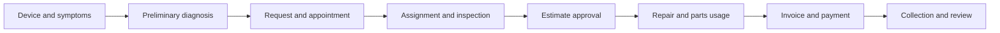
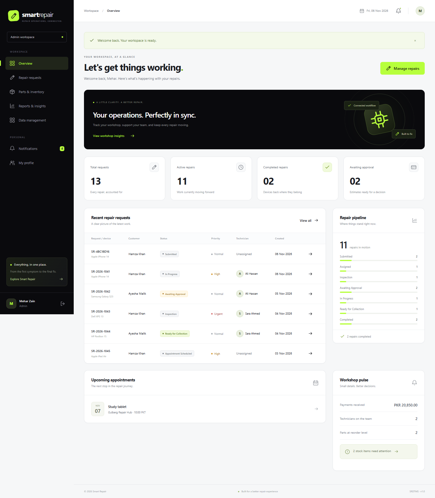
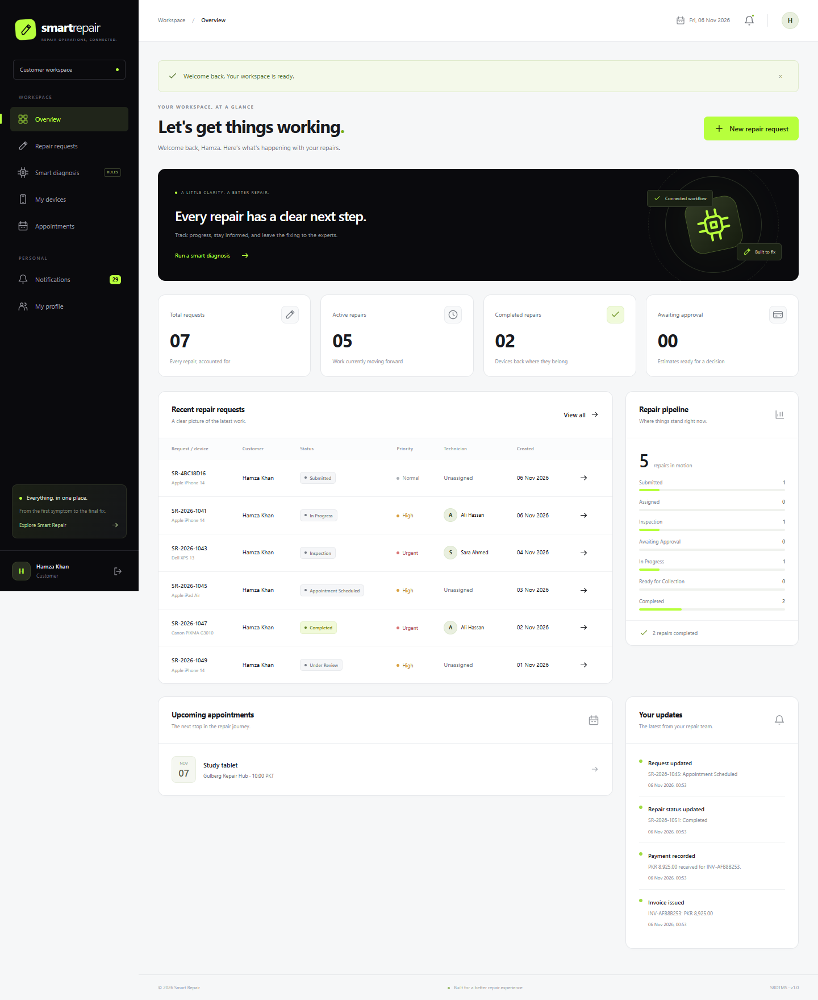
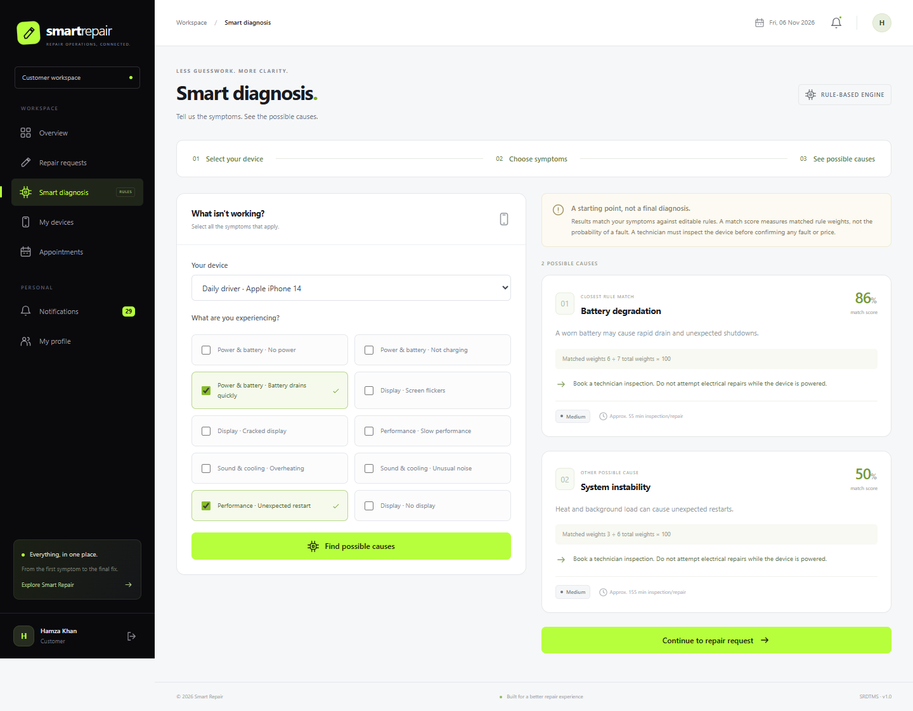
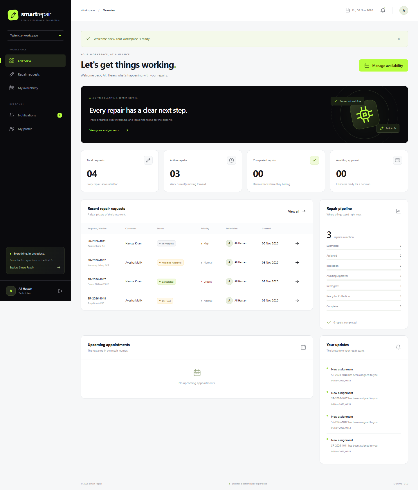
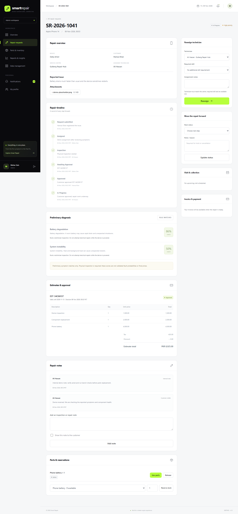

# Smart Repair Diagnosis & Technician Management System

**A connected repair-management application built with Flask, SQLAlchemy and Jinja2.**

[](https://github.com/omiijutt120/smart-repair-diagnosis-technician-management-system/actions/workflows/tests.yml)

Smart Repair brings customer intake, symptom-based diagnosis, workshop scheduling, technician assignments, spare-parts inventory and billing into one workflow. It is designed as an academic Web Engineering project with **40 related domain models**, three role-based workspaces and a reproducible demonstration dataset.

[Getting started](#getting-started) · [Features](#features) · [Screenshots](#screenshots) · [Database design](#database-design) · [Render deployment](#render-deployment) · [Documentation](#documentation)

## Overview

A customer registers a device, describes its symptoms and submits a repair request. A manager reviews the request and assigns a qualified technician. Inspection leads to an itemized estimate; the customer approves the work before repair begins. Parts consumption, progress updates, final invoicing, payment and feedback remain linked to the same repair.

Diagnosis uses an editable **rule-based knowledge base**. It provides possible causes and transparent match scores; a technician must confirm the fault and final price through physical inspection.



## Features

| Workspace | Capabilities |
|---|---|
| **Customer** | Register devices, select symptoms, run diagnosis, submit repair requests with attachments, book or reschedule appointments, approve estimates, track repairs, view invoices and leave feedback. |
| **Technician** | View assigned work, manage availability, record inspection findings, add internal or customer-visible notes, update permitted statuses and consume reserved parts. |
| **Administrator** | Manage users, roles, centres, device catalogues, technicians, skills, diagnostic rules, services, suppliers, stock, purchase orders, assignments, estimates, payments and operational reports. |

Additional capabilities include:

- Weighted symptom matching, required-symptom rules, ranked explanations and no-match guidance.
- Appointment conflict checks and skill/availability checks for technician assignment.
- Centralized repair-status transitions with actor, timestamp and history records.
- Inventory reservations, release, one-time consumption, purchase-order receipt and stock adjustments.
- Server-calculated estimates, customer approval, partial payments and overpayment prevention.
- In-app notifications, search, filters, paginated data lists and responsive layouts.
- Hashed passwords, server-side sessions, CSRF protection and ownership checks.
- Validated image/PDF attachments with randomized filenames and protected downloads.

## Technology

| Layer | Tools |
|---|---|
| Backend | Python 3.12.10, Flask, application factory and Blueprints |
| Database | SQLite, SQLAlchemy, Flask-SQLAlchemy |
| Migrations | Flask-Migrate / Alembic |
| Authentication | Flask-Login, Werkzeug password hashing, Flask-Session / CacheLib |
| Forms | Flask-WTF, WTForms, server-side validation |
| Frontend | Jinja2, HTML, CSS and JavaScript |
| Testing | Pytest, Flask test client, optional Playwright browser checks |
| Serving and deployment | Waitress, Render Blueprint |

The application runs without a frontend build or external API key. Node.js is needed only for the optional browser-check tooling.

## Screenshots

The interface uses midnight black, white and lime with responsive customer, technician and administrator workspaces.

<details>
<summary><strong>Administrator dashboard</strong></summary>



</details>

<details>
<summary><strong>Customer workspace and diagnosis results</strong></summary>





</details>

<details>
<summary><strong>Technician workspace and repair tracking</strong></summary>





</details>

Browse the [complete screenshot collection](docs/screenshots/), including inventory, CRUD screens, mobile views and the database schema.

## Getting started

### Prerequisites

- Python **3.12**; the supplied deployment configuration pins **3.12.10**.
- Git to clone the repository, or download and extract its source archive.
- Node.js and Microsoft Edge only if running the optional browser checks.

Run all commands from the project root, where `app.py` is located.

```bash
git clone https://github.com/omiijutt120/smart-repair-diagnosis-technician-management-system.git
cd smart-repair-diagnosis-technician-management-system
```

### Windows

Double-click **`start.cmd`** to install dependencies, apply migrations, seed the demonstration dataset and start the application. Keep its terminal open while using the app.

For manual setup in PowerShell, virtual-environment activation is optional:

```powershell
python -m venv .venv
.\.venv\Scripts\python.exe -m pip install -r requirements.txt
.\.venv\Scripts\python.exe -m flask --app app db upgrade
.\.venv\Scripts\python.exe -m flask --app app seed
.\.venv\Scripts\python.exe app.py
```

### Linux / macOS

```bash
python3 -m venv .venv
.venv/bin/python -m pip install -r requirements.txt
.venv/bin/python -m flask --app app db upgrade
.venv/bin/python -m flask --app app seed
.venv/bin/python app.py
```

Open **http://127.0.0.1:5000**. Stop the local development server with **Ctrl+C**.

## Demo accounts

After seeding, use the following fictional accounts. Their shared demonstration password is **`RepairDemo123!`**.

| Role | Email |
|---|---|
| Administrator | `admin@smartrepair.test` |
| Technician | `tech@smartrepair.test` |
| Technician, second skill profile | `tech2@smartrepair.test` |
| Customer | `customer@smartrepair.test` |
| Customer, second ownership profile | `customer2@smartrepair.test` |

The seed contains 2 centres, 5 device categories, 8 registered devices, 12 diagnosis rules, 8 spare parts, purchase orders and 12 repair requests across several stages. All 40 domain tables contain linked sample records.

Seeding is idempotent and preserves an existing user database. Technician availability covers 21 days from initial seeding; add fresh slots later through the technician or administrator workspace.

These credentials are intentionally shared for fictional demonstrations. A deployment handling real customer records needs private accounts and a separate production-readiness review.

## Configuration

Copy `.env.example` to `.env` to customize local configuration. Generate a secret before deployment:

```bash
python -c "import secrets; print(secrets.token_hex(32))"
```

| Variable | Purpose / default |
|---|---|
| `SECRET_KEY` | Application secret. If absent locally, a random key is generated once under ignored `instance/`. Required by the Render startup script. |
| `DATABASE_URL` | Defaults to `sqlite:///smart_repair.db` under Flask's `instance/` directory. |
| `MAX_UPLOAD_MB` | Maximum request upload size; defaults to 5 MB. |
| `SESSION_COOKIE_SECURE` | `false` for local HTTP; `true` for the HTTPS deployment. |
| `SEED_DEMO` | Render startup loads sample records when set to `true`. |
| `PORT` | Supplied by Render; the deployment server binds on `0.0.0.0`. |

SQLite data, uploads, session files and the local generated key live under **`instance/`**, which is excluded from version control. Only placeholder environment settings belong in the repository.

## Database design

The initial Alembic migration creates **exactly 40 domain tables**, plus Alembic's own version metadata table. Foreign keys connect the domain into one graph covering identity, catalogues, diagnosis, scheduling, repairs, inventory and billing.

- [Entity relationship diagram](docs/ERD.md)
- [Schema reference](docs/database-schema.html)
- [SQLite schema SQL](docs/schema.sql)
- [Per-model CRUD and history policies](docs/CRUD_COVERAGE.md)

Reference and draft records use validated administrator forms. Workflow services own generated records such as assignments, status events, stock usage and invoices. Historical records use controlled archive, cancel, void, refund or corrective operations where supported; immutable status and usage history is retained.

The tested database is SQLite. PostgreSQL would require its driver, concurrency adaptations and database-specific verification.

## Testing

```powershell
.\.venv\Scripts\python.exe -m pytest -q
.\.venv\Scripts\python.exe -m flask --app app db check
.\.venv\Scripts\python.exe -m pip check
```

On Linux/macOS, substitute `.venv/bin/python`. The GitHub Actions workflow runs dependency validation and the Python test suite on Linux for pushes and pull requests.

The test suite covers authentication, authorization, ownership, diagnosis scoring, scheduling conflicts, stock invariants, repair transitions, estimate approval, invoicing, partial payments, review eligibility, all-model connectivity, fresh migrations and Render startup. Mutation coverage is representative; it does not exhaustively test every operation on every model.

For browser checks, start the local application first, then run:

```powershell
npm.cmd ci
npm.cmd run test:browser
```

Set `BROWSER_PATH` to another Chromium executable or `TEST_BASE_URL` to another local port when needed. Browser checks save screenshots and create a labelled QA repair request in the selected demo database. The Node dependencies are development tools and are not required by Render.

## Render deployment

The repository includes a **Free Web Service** Blueprint:

1. Connect this repository through **Render → New → Blueprint**.
2. Review the service declared in `render.yaml` and select the branch to deploy.
3. Deploy and open the `onrender.com` URL assigned by Render.

The build installs `requirements.txt`. The startup command, **`python render_start.py`**, applies migrations, loads sample data idempotently and serves the application with Waitress. The Blueprint generates an application secret and enables secure cookies.

**Free-demo storage is temporary:** SQLite records, uploads and sessions can be lost when Render restarts, redeploys or spins down the service. The starter dataset can be recreated; newly entered records cannot be recovered by seeding.

See the [complete Render guide](docs/RENDER_DEPLOYMENT.md) for manual settings, account details, troubleshooting and persistence limitations. The Blueprint is deployment configuration; it does not imply that a live service already exists.

## Project structure

```text
.github/workflows/      Automated Python checks
app.py                 Local development entry point
render_start.py        Render migration, seed and server startup
render.yaml            Free Render service configuration
config.py              Environment-based application settings
smart_repair/
  auth/                Registration, login and logout
  customer/            Devices, diagnosis, intake and appointments
  technician/          Assigned work, notes, availability and parts usage
  admin/               Data-management policies and operations
  models/              Forty domain models in five modules
  services/            Diagnosis, workflow, stock, billing and upload logic
  templates/           Shared Jinja2 layout, macros and role-based screens
  static/              Local styles, JavaScript and vector assets
migrations/            Alembic migration history
tests/                 Isolated pytest acceptance tests
scripts/               Browser checks and submission packaging
docs/                  ERD, policies, deployment guide and screenshots
```

## Scope and known limitations

- Diagnosis is preliminary rule matching; payments are recorded manually or simulated.
- Appointments allow one simultaneous booking per centre. Unscheduled assignments check upcoming availability without promising a precise start time.
- Completed-job refunds require offline manager review. Receipt/usage corrections use stock adjustments rather than a direct linked reversal action.
- Some administrator cancellation paths remain available after inspection; strict pre-work-only cancellation is not enforced everywhere.
- The application is an academic demonstration. Live gateways, SMS/WhatsApp delivery, GPS tracking and image-based fault detection are outside its current scope.

## Documentation

| Document | Contents |
|---|---|
| [PRD mapping](docs/PRD_COMPLIANCE.md) | Requirements, academic rubric evidence and scope notes |
| [CRUD coverage](docs/CRUD_COVERAGE.md) | Model-level management and history policies |
| [Verification record](docs/VERIFICATION.md) | Recorded local checks and screenshot index |
| [Render guide](docs/RENDER_DEPLOYMENT.md) | Free-demo deployment and troubleshooting |
| [ER diagram](docs/ERD.md) | Relationships between all 40 domain models |

Original vector assets and styling are included locally. Development used AI-assisted tooling; review and understand the implementation and acknowledge assistance according to applicable course requirements.
